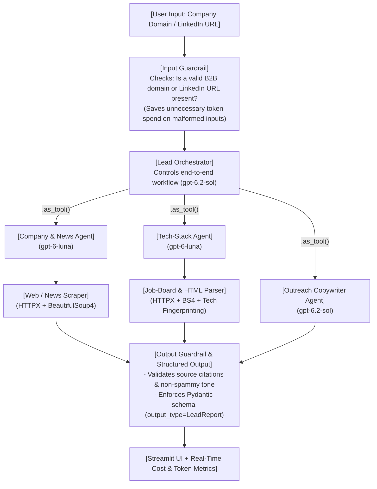

# 🎯 LinkedIn-to-Lead Intelligence & Outreach Agent

An autonomous multi-agent B2B sales research and hyper-personalized outreach pipeline built with the **OpenAI Agents SDK**, **Pydantic v2**, **HTTPX / BeautifulSoup4**, and **Streamlit**.

Given a company domain (e.g., `stripe.com`, `vercel.com`) or a LinkedIn URL, the agent team scrapes press releases, product updates, HTML tech-stack signatures, and engineering job postings to synthesize executive pain points and craft a source-grounded outreach pitch—complete with a **"Before (Generic AI) vs. After (Multi-Agent)"** comparison and real-time token/cost telemetry.

---

## ✨ Key Features

- **Multi-Agent Orchestration (`.as_tool()` Pattern):** Uses the OpenAI Agents SDK to coordinate three focused sub-agents (`Company & News Agent`, `Tech-Stack Agent`, and `Outreach Copywriter Agent`) under a central `Lead Orchestrator`.
- **Cost-Aware Model Routing:** Routes high-volume HTML scraping and job-board extraction tasks to a fast, low-cost model (`gpt-6-luna` / `gpt-4o-mini`) while reserving a high-reasoning model (`gpt-6.2-sol` / `gpt-4o`) for orchestration and executive copywriting—saving **~70%+ in token costs**.
- **Deterministic Structured Outputs:** Enforces strict JSON schemas using Pydantic v2 (`output_type=LeadReport`), eliminating unstructured Markdown chaos for seamless UI and CRM integration.
- **Built-in Input & Output Guardrails:**
  - *Input Guardrail:* Validates domain/LinkedIn URL format and blocks malformed inputs or private IPs before any LLM tokens are spent.
  - *Output Guardrail:* Verifies HTTP/HTTPS source citations, factual grounding, and non-spammy B2B tone.
- **Real-Time Observability:** Tracks per-agent latency, `input_tokens`, `output_tokens`, API request counts, and USD cost savings via `RunContextWrapper` and `RequestUsage`.
- **LinkedIn Showcase / Demo Mode:** Includes an interactive **Before vs. After** pitch comparison and zero-cost Showcase Mode in Streamlit for instant LinkedIn demos and screenshots.

---

## 🏗️ System Architecture



For a deep dive into the internals, see [`docs/architecture.md`](docs/architecture.md).

---

## 📂 Project Structure

```text
B2B-Lead-Intelligence-Outreach-Agent/
├── .github/workflows/ci.yml        # GitHub Actions CI (Ruff + Pytest)
├── docs/
│   └── architecture.md             # Detailed technical architecture documentation
├── src/lead_agent/
│   ├── __init__.py
│   ├── config.py                   # Cost-Aware Model Routing & pricing settings
│   ├── context.py                  # RunContextWrapper token & cost observability
│   ├── guardrails.py               # @input_guardrail and @output_guardrail definitions
│   ├── schemas.py                  # Pydantic v2 models (LeadReport, OutreachPitch, etc.)
│   ├── showcase.py                 # Built-in LinkedIn Before/After showcase fixtures
│   ├── agents/
│   │   ├── company_news_agent.py   # Fast-tier web & press release researcher
│   │   ├── tech_stack_agent.py     # Fast-tier HTML & job-board tech stack parser
│   │   ├── copywriter_agent.py     # Reasoning-tier B2B outreach copywriter
│   │   └── orchestrator.py         # Lead Orchestrator wiring sub-agents via .as_tool()
│   └── tools/
│       ├── web_scraper.py          # HTTPX + BeautifulSoup4 website & news scraper
│       └── tech_parser.py          # Tech fingerprinting & careers page parser
├── tests/                          # Comprehensive unit & integration test suite
├── ui/
│   └── app.py                      # Streamlit dashboard with Before/After & telemetry
├── .env.example                    # Environment variable template
├── pyproject.toml                  # Dependencies and tool configuration
└── README.md
```

---

## 🚀 Quickstart

### 1. Clone & Install Dependencies

```bash
pip install -e ".[dev]"
```

### 2. Configure Environment Variables

Copy `.env.example` to `.env` and add your OpenAI API key:

```bash
cp .env.example .env
```

```dotenv
OPENAI_API_KEY="sk-YOUR_OPENAI_API_KEY"
FAST_MODEL="gpt-6-luna"
REASONING_MODEL="gpt-6.2-sol"
```

*(Note: You can run the app immediately in **Showcase / Demo Mode** without an API key, or switch between `gpt-6-luna` / `gpt-6.2-sol` and `gpt-4o-mini` / `gpt-4o` directly in the Streamlit sidebar.)*

### 3. Launch the Streamlit UI

```bash
streamlit run ui/app.py
```

---

## 🧪 Running Tests & Linting

Run the automated test suite and code quality checks:

```bash
pytest -v
ruff check src tests ui
```

---

## 💡 LinkedIn Showcase Tip ("Before vs. After")

1. Open the app (`streamlit run ui/app.py`) and select **✨ Showcase / Demo Mode** (or **🚀 Live OpenAI Agents SDK Mode**).
2. Click **💳 Showcase: stripe.com** or **▲ Showcase: vercel.com**, or enter any B2B domain.
3. Open the **🔥 Before vs. After Outreach (LinkedIn Hook)** tab to capture a side-by-side comparison between a generic single-prompt AI cold message and the multi-agent, source-grounded pitch.
4. Open the **📊 Token & Cost Observability** tab to show how Cost-Aware Model Routing cuts token spend by >70% while enforcing deterministic Pydantic outputs (`LeadReport`).
