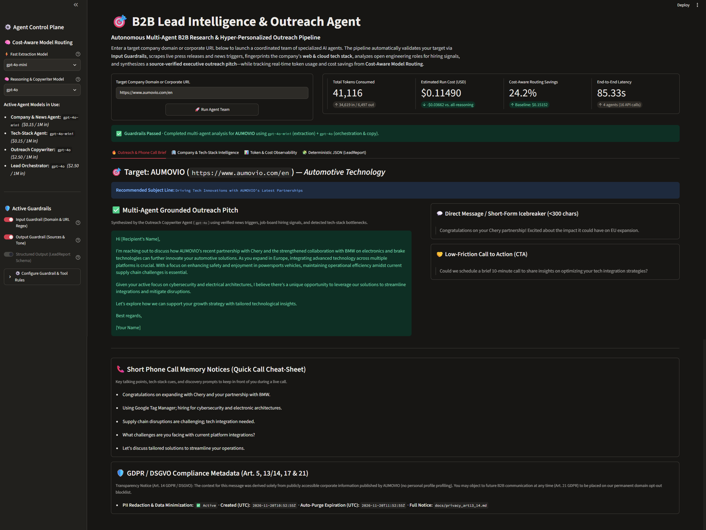
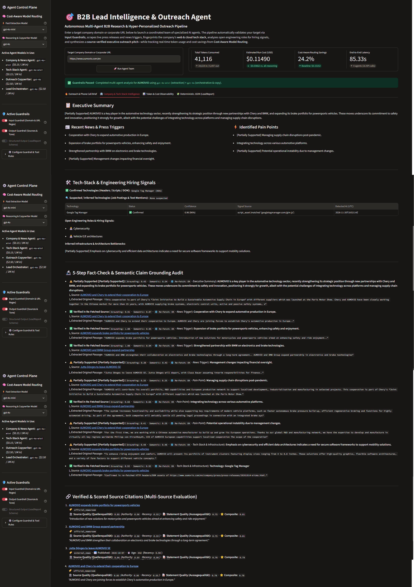

# B2B Lead Intelligence & Outreach Agent
## ✨Ideation and Implementation
- Ideation: ChatGPT and Gemini 3 Pro
- Implementation: Antigravity Agent

An autonomous multi-agent B2B sales research and hyper-personalized outreach pipeline built with the **OpenAI Agents SDK**, **Pydantic v2**, **HTTPX / BeautifulSoup4**, and **Streamlit**.

Given a target company domain (e.g., `bmwgroup.com/en`, `stripe.com`, `vercel.com`) or corporate URL, the agent team validates the target through configurable **Input Guardrails**, scrapes press releases and company news across multiple channels, fingerprints the web & cloud tech stack with evidence-based confidence scores, analyzes open engineering job postings for hiring signals, verifies claims against re-fetched source passages, and synthesizes an executive **Outreach & Phone Call Brief** (grounded email pitch, short-form DM icebreaker, low-friction CTA, and a 5-point live phone call cheat-sheet) with real-time token and cost telemetry.

## Example Output


---

## ✨ Key Features

For a comprehensive overview of all core capabilities—including Multi-Agent Orchestration (`.as_tool()`), Cost-Aware Model Routing, Multi-Source Research & Dual Scoring, the 5-Step Semantic Fact-Checker, Evidence-Based Tech-Stack Detection, IP-Pinned SSRF Defense, and the GDPR / DSGVO Privacy-by-Design Engine—see [`docs/keyfeatures.md`](docs/keyfeatures.md).

---

## 🏗️ System Architecture


For a deep dive into the internals, model alias resolution, guardrail policy rules, and persistent async event-loop management, see [`docs/architecture.md`](docs/architecture.md).

---

## 📂 Project Structure

```text
B2B-Lead-Intelligence-Outreach-Agent/
├── .github/workflows/ci.yml        # GitHub Actions CI (Ruff + Pytest)
├── docs/
│   ├── architecture.md             # Detailed technical architecture documentation
│   ├── failed_tests.md             # Historical failed-test post-mortems & fail-closed negative test catalog
│   ├── keyfeatures.md              # Detailed overview of all key features and capabilities
│   ├── privacy_art13_14.md         # GDPR / DSGVO Art. 13 & Art. 14 transparency & compliance documentation
│   └── test_report.md              # Full 73-test execution report & coverage breakdown
├── gallery/
│   └── b2b_latest.png              # Pictures
├── src/lead_agent/
│   ├── __init__.py
│   ├── config.py                   # Cost-Aware Routing, pricing & guardrail policy settings
│   ├── context.py                  # RunContextWrapper token & cost observability
│   ├── fact_checker.py             # 5-step source re-fetch, passage extraction & claim verification
│   ├── guardrails.py               # Configurable @input_guardrail & @output_guardrail
│   ├── privacy.py                  # GDPR / DSGVO PII filtering, data minimization, retention TTL & Art. 21 blocklist
│   ├── schemas.py                  # Pydantic v2 models (LeadReport, VerifiedClaim, etc.)
│   ├── security.py                 # Multi-layer SSRF protection, DNS checks & redirect-safe HTTP client
│   ├── agents/
│   │   ├── company_news_agent.py   # Fast-tier web & press release researcher
│   │   ├── tech_stack_agent.py     # Fast-tier HTML & job-board tech stack parser
│   │   ├── copywriter_agent.py     # Reasoning-tier B2B outreach copywriter
│   │   └── orchestrator.py         # Lead Orchestrator wiring sub-agents via .as_tool()
│   └── tools/
│       ├── research_engine.py      # Multi-source news aggregator, JSON-LD/SPA extractor & source scoring
│       ├── web_scraper.py          # Website & multi-channel press scraper
│       └── tech_parser.py          # Tech fingerprinting & careers page parser
├── tests/                          # Comprehensive unit & integration test suite (73 tests)
├── ui/
│   └── app.py                      # Streamlit production UI & guardrail control plane
├── .env.example                    # Environment variable template
├── LICENSE                         # Apache License 2.0 (Apache-2.0)
├── pyproject.toml                  # Dependencies and tool configuration
└── README.md
```

---

## 🚀 Quickstart

### 1. Install Dependencies

```powershell
pip install -e ".[dev]"
```

### 2. Configure Environment Variables

Copy `.env.example` to `.env` and set your OpenAI API key:

```powershell
# Windows (CMD / PowerShell)
copy .env.example .env

# macOS / Linux
cp .env.example .env
```

```dotenv
OPENAI_API_KEY="sk-YOUR_OPENAI_API_KEY"
FAST_MODEL="gpt-4o-mini"
REASONING_MODEL="gpt-4o"
```

### 3. Launch the Streamlit Application

```powershell
python -m streamlit run ui/app.py
```

---

## 🧪 Running Tests & Linting

Run the automated test suite and code quality checks:

```powershell
python -m pytest -v
python -m ruff check src tests ui
```

Detailed test documentation is available in [`docs/test_report.md`](docs/test_report.md) and [`docs/failed_tests.md`](docs/failed_tests.md).

---

## 📄 License

This project is licensed under the **Apache License 2.0** (`Apache-2.0`). See the [LICENSE](LICENSE) file for full details.
