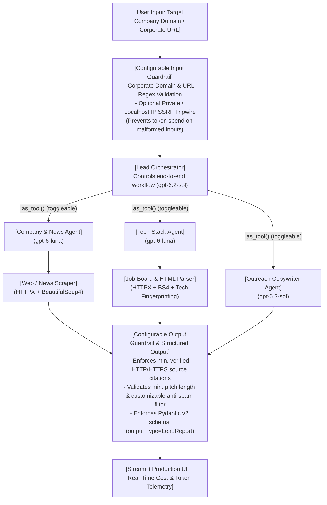

# 🎯 B2B Lead Intelligence & Outreach Agent

An autonomous multi-agent B2B sales research and hyper-personalized outreach pipeline built with the **OpenAI Agents SDK**, **Pydantic v2**, **HTTPX / BeautifulSoup4**, and **Streamlit**.

Given a target company domain (e.g., `bmwgroup.com/en`, `stripe.com`, `vercel.com`) or corporate URL, the agent team validates the target through configurable **Input Guardrails**, scrapes press releases and company news, fingerprints the web & cloud tech stack, analyzes open engineering job postings for hiring signals, and synthesizes a source-verified executive outreach pitch—complete with a **"Standard Single-Prompt Baseline vs. Multi-Agent Grounded Pitch"** comparison and real-time token/cost telemetry.

---

## ✨ Key Features

- **Multi-Agent Orchestration (`.as_tool()` Pattern):** Uses the OpenAI Agents SDK to coordinate three specialized sub-agents (`Company & News Agent`, `Tech-Stack Agent`, and `Outreach Copywriter Agent`) under a central `Lead Orchestrator`.
- **Cost-Aware Model Routing:** Routes high-volume HTML scraping and job-board extraction tasks to a fast, low-cost model tier (`gpt-6-luna` / `gpt-4o-mini`) while reserving a high-reasoning model tier (`gpt-6.2-sol` / `gpt-4o`) for orchestration and executive copywriting.
- **Configurable Guardrails & Policy Control Plane:**
  - *Input Guardrail:* Validates domain/corporate URL format and blocks malformed inputs or private/localhost IPs (SSRF protection) before any LLM tokens are spent.
  - *Modular `.as_tool()` Toggles:* Enable or disable individual sub-agents on the fly from the Streamlit sidebar.
  - *Output Guardrail:* Enforces configurable minimum verified HTTP/HTTPS source citations, minimum pitch length, and customizable anti-spam phrase filtering.
- **Deterministic Structured Outputs:** Enforces strict JSON schemas using Pydantic v2 (`output_type=LeadReport`), eliminating unstructured Markdown chaos for reliable UI rendering and downstream CRM export.
- **Real-Time Observability:** Tracks per-agent latency, `input_tokens`, `output_tokens`, API request counts, and USD cost savings via `RunContextWrapper` and `RequestUsage` in a live 4-column telemetry card.

---

## 🏗️ System Architecture



For a deep dive into the internals, model alias resolution, guardrail policy rules, and persistent async event-loop management, see [`docs/architecture.md`](docs/architecture.md).

---

## 📂 Project Structure

```text
B2B-Lead-Intelligence-Outreach-Agent/
├── .github/workflows/ci.yml        # GitHub Actions CI (Ruff + Pytest)
├── docs/
│   └── architecture.md             # Detailed technical architecture documentation
├── src/lead_agent/
│   ├── __init__.py
│   ├── config.py                   # Cost-Aware Routing, pricing & guardrail policy settings
│   ├── context.py                  # RunContextWrapper token & cost observability
│   ├── guardrails.py               # Configurable @input_guardrail & @output_guardrail
│   ├── schemas.py                  # Pydantic v2 models (LeadReport, OutreachPitch, etc.)
│   ├── agents/
│   │   ├── company_news_agent.py   # Fast-tier web & press release researcher
│   │   ├── tech_stack_agent.py     # Fast-tier HTML & job-board tech stack parser
│   │   ├── copywriter_agent.py     # Reasoning-tier B2B outreach copywriter
│   │   └── orchestrator.py         # Lead Orchestrator wiring sub-agents via .as_tool()
│   └── tools/
│       ├── web_scraper.py          # HTTPX + BeautifulSoup4 website & news scraper
│       └── tech_parser.py          # Tech fingerprinting & careers page parser
├── tests/                          # Comprehensive unit & integration test suite (26 tests)
├── ui/
│   └── app.py                      # Streamlit production UI & guardrail control plane
├── .env.example                    # Environment variable template
├── pyproject.toml                  # Dependencies and tool configuration
└── README.md
```

---

## 🚀 Quickstart

### 1. Install Dependencies

```powershell
pip install -e ".[dev]"
```

### 2. Configure Environment Variables

Copy `.env.example` to `.env` and set your OpenAI API key:

```powershell
# Windows (CMD / PowerShell)
copy .env.example .env

# macOS / Linux
cp .env.example .env
```

```dotenv
OPENAI_API_KEY="sk-YOUR_OPENAI_API_KEY"
FAST_MODEL="gpt-6-luna"
REASONING_MODEL="gpt-6.2-sol"
```

### 3. Launch the Streamlit Application

```powershell
python -m streamlit run ui/app.py
```

---

## 🧪 Running Tests & Linting

Run the automated test suite and code quality checks:

```powershell
python -m pytest -v
python -m ruff check src tests ui
```
