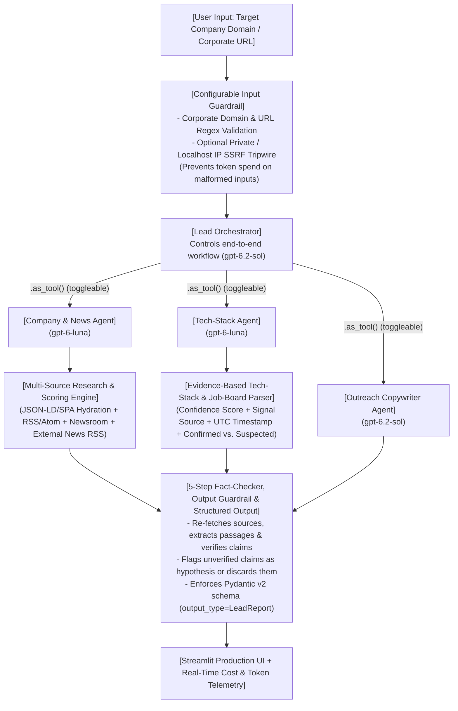

# System Architecture — B2B Lead Intelligence & Outreach Agent

## 1. End-to-End Architecture Overview

The **B2B Lead Intelligence & Outreach Agent** uses the **OpenAI Agents SDK** (`Agents-as-Tools` pattern via `.as_tool()`) to separate high-volume web scraping and HTML parsing from high-reasoning synthesis and executive copywriting.

---

## 2. Multi-Agent Roles & Cost-Aware Model Routing

A common anti-pattern in agentic workflows is sending raw HTML, press releases, and job descriptions directly into a frontier reasoning model. In this architecture, tasks are split across two pricing tiers configured in [`src/lead_agent/config.py`](../src/lead_agent/config.py):

| Agent | Role | Default Model (`LIVE_MODEL_ALIASES`) | Tier | Tools / Output |
| :--- | :--- | :--- | :--- | :--- |
| **Company & News Agent** | Scrapes homepage, `/news`, `/press`, and `/blog` to extract strategic triggers | `gpt-6-luna` (`gpt-4o-mini`) | ⚡ Fast (`$0.15 / 1M in`) | `scrape_company_website`, `fetch_company_news_and_press` |
| **Tech-Stack Agent** | Fingerprints HTTP headers, DOM scripts, and `/careers` job boards for tech signals | `gpt-6-luna` (`gpt-4o-mini`) | ⚡ Fast (`$0.15 / 1M in`) | `detect_website_tech_stack`, `scrape_careers_and_job_postings` |
| **Outreach Copywriter Agent** | Synthesizes research into a single-prompt baseline vs. multi-agent grounded pitch | `gpt-6.2-sol` (`gpt-4o`) | 🧠 Reasoning (`$2.50 / 1M in`) | `output_type=OutreachPitch` |
| **Lead Orchestrator** | Coordinates `.as_tool()` sub-agents, enforces guardrails, and emits `LeadReport` | `gpt-6.2-sol` (`gpt-4o`) | 🧠 Reasoning (`$2.50 / 1M in`) | `output_type=LeadReport` |

### Why Cost-Aware Routing Matters
A large share of total input tokens occurs during raw webpage and job-board ingestion. By routing the `Company & News Agent` and `Tech-Stack Agent` to the fast tier (`gpt-6-luna` / `gpt-4o-mini`) while reserving the reasoning tier (`gpt-6.2-sol` / `gpt-4o`) for orchestration and final pitch synthesis, total run cost is reduced significantly compared to an all-reasoning baseline without sacrificing copywriting quality.

### Live Model Alias Resolution (`resolve_live_model_name`)
In [`src/lead_agent/agents/orchestrator.py`](../src/lead_agent/agents/orchestrator.py), `LIVE_MODEL_ALIASES` transparently maps the architectural specification model names (`gpt-6-luna` → `gpt-4o-mini`, `gpt-6.2-sol` → `gpt-4o`) when calling the live OpenAI API while preserving the configured model identifiers and pricing tiers in telemetry reports.

---

## 3. Configurable Guardrails & Sub-Agent Policy (`src/lead_agent/guardrails.py` & `config.py`)

All guardrails and `.as_tool()` sub-agent delegations are dynamically configurable at runtime via `AgentSettings` and the Streamlit sidebar Control Plane:

### 1. Input Guardrail (`@input_guardrail`)
- **`enable_input_guardrail` (`bool`, default `True`):** Executed **before** the orchestrator invokes any LLM or sub-agent. Validates that the user provided a well-formed corporate domain (e.g., `bmwgroup.com/en`, `stripe.com`, `https://vercel.com`).
- **`block_private_ips` (`bool`, default `True`):** SSRF tripwire that blocks loopback and private network targets (`localhost`, `127.0.0.1`, `0.0.0.0`, `::1`, `.local`, `.internal`) by triggering `tripwire_triggered=True`.

### 2. Modular Agents-as-Tools (`.as_tool()`) Delegation
- **`enable_company_news_agent` (`bool`, default `True`):** Attaches/detaches `company_news_research_tool`.
- **`enable_tech_stack_agent` (`bool`, default `True`):** Attaches/detaches `tech_stack_detection_tool`.
- **`enable_copywriter_agent` (`bool`, default `True`):** Attaches/detaches `outreach_copywriter_tool`.

### 3. Output Guardrail (`@output_guardrail`)
- **`enable_output_guardrail` (`bool`, default `True`):** Validates the structured `LeadReport` before returning it to the UI or downstream CRM.
- **`min_sources_required` (`int`, default `1`):** Enforces a minimum count of verified `http://` or `https://` citations in `report.sources`.
- **`min_source_credibility` (`float`, default `0.50`):** Rejects reports whose sources fall below the configured composite quality threshold.
- **`min_pitch_length` (`int`, default `40`):** Ensures `hyper_personalized_pitch` meets minimum character length thresholds.
- **`enable_anti_spam_check` (`bool`, default `True`) & `blocked_spam_phrases` (`tuple[str, ...]`):** Scans generated outreach copy against a customizable list of prohibited spam clichés.

---

## 3b. Multi-Source Research & Source Evaluation Engine (`src/lead_agent/tools/research_engine.py`)

To overcome the limitations of simple static HTML scraping on modern B2B websites, the research pipeline combines four discovery channels and a deterministic source scoring algorithm:

1. **JS-Heavy Website & SPA State Recovery:**
   - Parses `<script type="application/ld+json">` (`NewsArticle`, `Organization`, `WebPage`) and Next.js `__NEXT_DATA__` hydration state payloads to recover dynamic headlines, article bodies, and publication timestamps even when static `<body>` tags are minimal.
   - Automatically triggers a headless reader fallback (`r.jina.ai`) when static + hydrated HTML contains fewer than 250 characters.
2. **Multi-Channel Press & News Aggregation:**
   - **Auto-Discovered RSS / Atom Feeds:** Detects `<link rel="alternate" type="application/rss+xml|application/atom+xml">` and probes `/feed`, `/rss.xml`, `/blog/rss.xml`.
   - **Deep Corporate Newsroom Crawler:** Crawls `/newsroom`, `/press`, `/news`, `/blog` and follows discovered press links from the homepage.
   - **External News & Press Wires (Google News RSS):** Queries external press coverage and Tier-1 news wires (`prnewswire.com`, `businesswire.com`, `reuters.com`, `techcrunch.com`, `handelsblatt.com`, etc.).
3. **Deterministic Source Quality Scoring (`evaluate_source_quality`):**
   - **`credibility_score` (`0.0–1.0`, weight 45%):** Evaluates domain authority and provenance (first-party official newsroom `0.96`, Tier-1 press wires `0.92`, first-party domain `0.90`, verified external news `0.85`).
   - **`relevance_score` (`0.0–1.0`, weight 40%):** Measures company mention presence, B2B trigger keyword density (`launch`, `partnership`, `funding`, `quarterly`, `enterprise`, `ai`, `cloud`), and snippet depth.
   - **`composite_score` (`0.0–1.0`, includes 15% recency weight):** Ranks and deduplicates sources best-first before synthesis and Output Guardrail validation.

---

## 3c. 5-Step Fact-Verification & Claim-Grounding Engine (`src/lead_agent/fact_checker.py`)

To ensure that a valid HTTP/HTTPS URL actually backs the specific claims made in the report (rather than merely pointing to a generic homepage), [`src/lead_agent/fact_checker.py`](../src/lead_agent/fact_checker.py) executes a 5-step verification pipeline before the final `LeadReport` is returned:

1. **Claim-to-Source Mapping (`select_best_source_for_claim`):** Links every key statement in `recent_news_and_triggers` and `identified_pain_points` to its best-matching cited `SourceCitation`.
2. **Source Re-Fetching (`refetch_sources_corpus`):** Re-fetches the cited URLs (`httpx.AsyncClient` + `extract_clean_page_data`) to inspect the full original document text, headings, and JSON-LD metadata.
3. **Passage Extraction (`extract_best_matching_passage`):** Splits the original source text into sliding sentence windows and extracts the specific passage (`matched_excerpt`) with the highest lexical, stem, and high-signal entity/numeric overlap.
4. **Claim-vs-Passage Comparison (`classify_verification_status`):** Computes a `grounding_score` (`0.00–1.00`) and classifies each claim as:
   - `verified` (`✅ Verified in Source`)
   - `partially_supported` (`⚠️ Partially Grounded`)
   - `inferred_hypothesis` (`🔍 Marked as Hypothesis`, when `grounding_score < min_grounding_score`)
5. **Unverified Claim Policy Enforcement (`_apply_unverified_policy_to_claims`):** Depending on `settings.unverified_claim_policy` (configurable in the Streamlit sidebar), unverifiable claims are either explicitly prefixed with `"[Hypothesis / Inferred] "` or discarded from the report. Every audited claim is stored in `report.verified_claims` (`list[VerifiedClaim]`) and rendered in the UI's **5-Step Fact-Check & Claim Grounding Audit** view.

---

## 3d. Evidence-Based Tech-Stack Detection (`src/lead_agent/tools/tech_parser.py`)

To prevent false positives (such as flagging `Kubernetes` or `AWS` as confirmed infrastructure simply because a blog paragraph mentions the word), `parse_tech_signals_detailed` and `parse_job_board_signals` record a structured `DetectedTechnology` evidence record for every signal:

- **`confidence_score` (`0.00–1.00`):** Weighted by signal reliability, with a `+0.04` corroboration bonus when multiple independent signals confirm the same technology.
- **`signal_source`:** Exact provenance of the signal:
  - `http_header` (e.g., `server: cloudflare`, `x-vercel-id`, `x-amz-cf-id` → `0.94–0.98`)
  - `meta_generator` (e.g., `<meta name="generator" content="Astro v4.0">` → `0.95`)
  - `script_or_dom_asset` / `script_asset` (e.g., `/_next/static/`, `id=__NEXT_DATA__`, `js.stripe.com`, `cdn.segment.com` → `0.88–0.96`)
  - `job_posting_requirement` (e.g., engineering role requirements on `/careers` → `0.60–0.78`)
  - `body_text_mention` (plain text mention in page prose without runtime header/asset proof → `0.50–0.55`)
- **`detected_at`:** ISO-8601 UTC timestamp (`YYYY-MM-DDTHH:MM:SSZ`) of the detection.
- **`detection_status` (`confirmed` vs. `suspected`):**
  - **`confirmed` (*sicher erkannt*, `confidence_score >= 0.80`):** Backed by direct runtime evidence (HTTP headers, script/link assets, DOM attributes, or meta generator tags).
  - **`suspected` (*vermutet*, `confidence_score < 0.80`):** Inferred from job board requirements or plain-text prose mentions.

---

## 4. Deterministic Structured Outputs (`src/lead_agent/schemas.py`)

By passing `output_type=LeadReport` to the `Lead Orchestrator`, the OpenAI Agents SDK enforces strict adherence to the Pydantic v2 schema:
- `LeadReport`: Top-level container with `company_name`, `target_domain`, `industry`, `executive_summary`, `recent_news_and_triggers`, and `identified_pain_points`.
- `TechStackAnalysis`: Lists `detected_technologies`, `hiring_signals`, and `inferred_infrastructure_needs`.
- `OutreachPitch`: Contains both `generic_ai_message` (Standard Single-Prompt Baseline) and `hyper_personalized_pitch` (Multi-Agent Grounded Pitch), plus `subject_line`, `icebreaker_hook`, and `call_to_action`.
- `SourceCitation`: Enforces valid HTTP/HTTPS URLs (`url`), `title`, and factual `snippet`.

---

## 5. Real-Time Observability & Streamlit Async Architecture (`src/lead_agent/context.py` & `ui/app.py`)

### Token & Cost Telemetry
`LeadRunContext` is passed across the execution tree via `RunContextWrapper[LeadRunContext]`. Combined with `TelemetryAgentHooks` (`on_start` / `on_end`) and SDK `RequestUsage`:
- Tracks `input_tokens`, `output_tokens`, `total_tokens`, `requests`, and wall-clock `latency_seconds` per agent.
- Computes both the **actual routed cost** and the **hypothetical all-reasoning baseline cost**, surfacing exact dollar and percentage savings live in the 4-column Telemetry Card.

### Persistent Background Event-Loop Thread (`_get_background_event_loop`)
Streamlit runs inside an asynchronous Uvicorn server and re-executes the UI script on every widget interaction. To prevent `RuntimeError: Event loop is closed` or collisions with Uvicorn's thread loop across reruns:
- [`ui/app.py`](../ui/app.py) initializes a dedicated background daemon thread via `@st.cache_resource` running a persistent `asyncio` event loop (`loop.run_forever()`).
- Agent pipeline executions are submitted thread-safely via `asyncio.run_coroutine_threadsafe(coro, loop).result()`, keeping the SDK's internal `AsyncOpenAI` / `httpx.AsyncClient` connection pool bound to a single open event loop throughout the application lifecycle.
