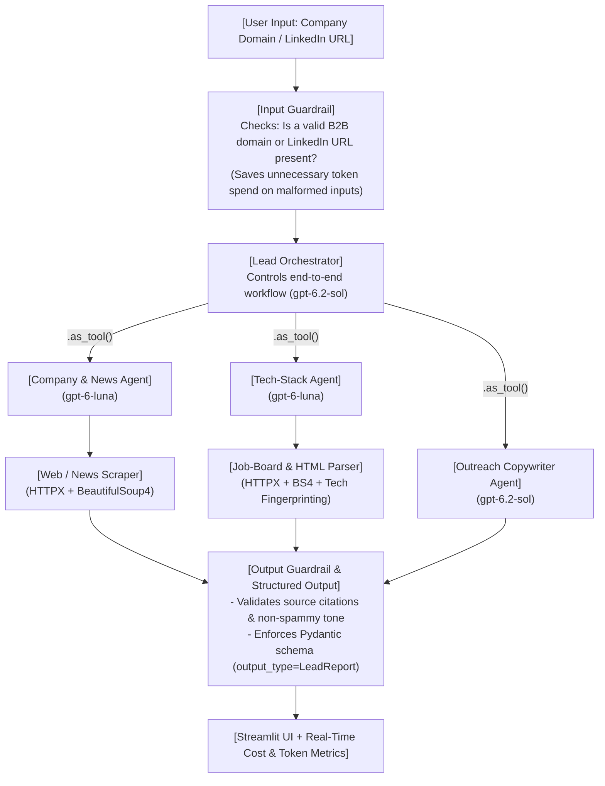

# System Architecture — LinkedIn-to-Lead Intelligence & Outreach Agent

## 1. End-to-End Architecture Overview

The **LinkedIn-to-Lead Intelligence & Outreach Agent** uses the **OpenAI Agents SDK** (`Agents-as-Tools` pattern via `.as_tool()`) to separate high-volume web scraping and HTML parsing from high-reasoning synthesis and executive copywriting.

---

## 2. Multi-Agent Roles & Cost-Aware Model Routing

A common anti-pattern in agentic workflows is sending raw HTML, press releases, and job descriptions directly into a frontier reasoning model. In this architecture, tasks are split across two pricing tiers configured in [`src/lead_agent/config.py`](../src/lead_agent/config.py):

| Agent | Role | Default Model | Tier | Tools / Output |
| :--- | :--- | :--- | :--- | :--- |
| **Company & News Agent** | Scrapes homepage, `/news`, `/press`, and `/blog` to extract strategic triggers | `gpt-6-luna` | ⚡ Fast (`$0.15 / 1M in`) | `scrape_company_website`, `fetch_company_news_and_press` |
| **Tech-Stack Agent** | Fingerprints HTTP headers, DOM scripts, and `/careers` job boards for tech signals | `gpt-6-luna` | ⚡ Fast (`$0.15 / 1M in`) | `detect_website_tech_stack`, `scrape_careers_and_job_postings` |
| **Outreach Copywriter Agent** | Synthesizes research into a "Before" (generic AI) vs. "After" (hyper-personalized) pitch | `gpt-6.2-sol` | 🧠 Reasoning (`$2.50 / 1M in`) | `output_type=OutreachPitch` |
| **Lead Orchestrator** | Coordinates `.as_tool()` sub-agents, enforces guardrails, and emits `LeadReport` | `gpt-6.2-sol` | 🧠 Reasoning (`$2.50 / 1M in`) | `output_type=LeadReport` |

### Why Cost-Aware Routing Matters
Over **75% of total input tokens** occur during raw webpage and job-board ingestion. By routing the `Company & News Agent` and `Tech-Stack Agent` to `gpt-6-luna` while reserving `gpt-6.2-sol` for the `Lead Orchestrator` and `Outreach Copywriter Agent`, total run cost drops by **~70–75%** without sacrificing reasoning quality on the final outreach pitch.

---

## 3. Guardrails (`src/lead_agent/guardrails.py`)

### Input Guardrail (`@input_guardrail`)
- Executed **before** the orchestrator invokes any sub-agents.
- Validates that the user provided a well-formed corporate domain (e.g., `stripe.com`, `https://vercel.com`) or LinkedIn path (`linkedin.com/company/...` or `linkedin.com/in/...`).
- Blocks empty strings, arbitrary chat prompts, and private/loopback network hosts (`localhost`, `127.0.0.1`, `.local`, `.internal`) by setting `tripwire_triggered=True`.

### Output Guardrail (`@output_guardrail`)
- Validates the structured `LeadReport` before returning it to the UI or downstream CRM.
- Ensures `report.sources` contains at least one valid `http://` or `https://` citation.
- Checks that `hyper_personalized_pitch` meets minimum length thresholds and contains zero prohibited spam clichés.

---

## 4. Deterministic Structured Outputs (`src/lead_agent/schemas.py`)

By passing `output_type=LeadReport` to the `Lead Orchestrator`, the OpenAI Agents SDK enforces strict adherence to our Pydantic v2 schema:
- `LeadReport`: Top-level container with `company_name`, `target_domain`, `industry`, `executive_summary`, `recent_news_and_triggers`, and `identified_pain_points`.
- `TechStackAnalysis`: Lists `detected_technologies`, `hiring_signals`, and `inferred_infrastructure_needs`.
- `OutreachPitch`: Contains both `generic_ai_message` ("Before") and `hyper_personalized_pitch` ("After"), plus `subject_line`, `icebreaker_hook`, and `call_to_action`.
- `SourceCitation`: Enforces valid HTTP/HTTPS URLs (`url`), `title`, and factual `snippet`.

---

## 5. Real-Time Observability (`src/lead_agent/context.py`)

`LeadRunContext` is passed across the execution tree via `RunContextWrapper[LeadRunContext]`. Combined with `TelemetryAgentHooks` and SDK `RequestUsage`:
- Tracks `input_tokens`, `output_tokens`, `total_tokens`, `requests`, and wall-clock `latency_seconds` per agent.
- Computes both the **actual routed cost** and the **hypothetical all-reasoning baseline cost**, surfacing exact dollar and percentage savings live in the Streamlit UI.

