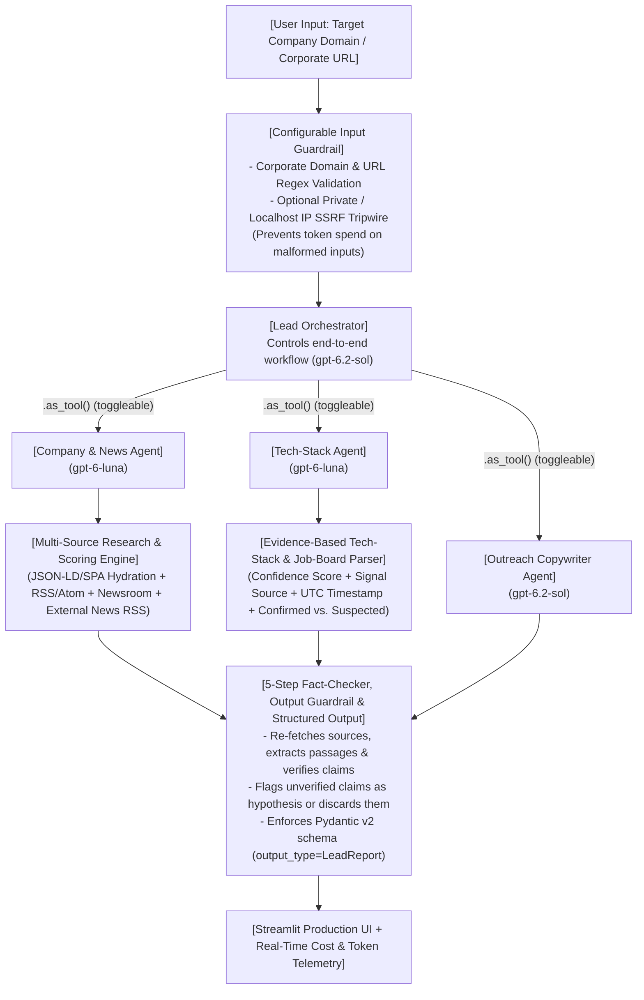

# System Architecture — B2B Lead Intelligence & Outreach Agent

## 1. End-to-End Architecture Overview

The **B2B Lead Intelligence & Outreach Agent** uses the **OpenAI Agents SDK** (`Agents-as-Tools` pattern via `.as_tool()`) to separate high-volume web scraping and HTML parsing from high-reasoning synthesis and executive copywriting.

---

## 2. Multi-Agent Roles & Cost-Aware Model Routing

A common anti-pattern in agentic workflows is sending raw HTML, press releases, and job descriptions directly into a frontier reasoning model. In this architecture, tasks are split across two pricing tiers configured in [`src/lead_agent/config.py`](../src/lead_agent/config.py):

| Agent | Role | Default Model (`LIVE_MODEL_ALIASES`) | Tier | Tools / Output |
| :--- | :--- | :--- | :--- | :--- |
| **Company & News Agent** | Scrapes homepage, `/news`, `/press`, and `/blog` to extract strategic triggers | `gpt-6-luna` (`gpt-4o-mini`) | ⚡ Fast (`$0.15 / 1M in`) | `scrape_company_website`, `fetch_company_news_and_press` |
| **Tech-Stack Agent** | Fingerprints HTTP headers, DOM scripts, and `/careers` job boards for tech signals | `gpt-6-luna` (`gpt-4o-mini`) | ⚡ Fast (`$0.15 / 1M in`) | `detect_website_tech_stack`, `scrape_careers_and_job_postings` |
| **Outreach Copywriter Agent** | Synthesizes research into a grounded email pitch, DM hook, CTA, and 5-point phone call cheat-sheet | `gpt-6.2-sol` (`gpt-4o`) | 🧠 Reasoning (`$2.50 / 1M in`) | `output_type=OutreachPitch` |
| **Lead Orchestrator** | Coordinates `.as_tool()` sub-agents, enforces guardrails, and emits `LeadReport` | `gpt-6.2-sol` (`gpt-4o`) | 🧠 Reasoning (`$2.50 / 1M in`) | `output_type=LeadReport` |

### Why Cost-Aware Routing Matters
A large share of total input tokens occurs during raw webpage and job-board ingestion. By routing the `Company & News Agent` and `Tech-Stack Agent` to the fast tier (`gpt-6-luna` / `gpt-4o-mini`) while reserving the reasoning tier (`gpt-6.2-sol` / `gpt-4o`) for orchestration and final pitch synthesis, total run cost is reduced significantly compared to an all-reasoning baseline without sacrificing copywriting quality.

### Live Model Alias Resolution (`resolve_live_model_name`)
In [`src/lead_agent/agents/orchestrator.py`](../src/lead_agent/agents/orchestrator.py), `LIVE_MODEL_ALIASES` transparently maps the architectural specification model names (`gpt-6-luna` → `gpt-4o-mini`, `gpt-6.2-sol` → `gpt-4o`) when calling the live OpenAI API while preserving the configured model identifiers and pricing tiers in telemetry reports.

---

## 3. Configurable Guardrails & Sub-Agent Policy (`src/lead_agent/guardrails.py` & `config.py`)

All guardrails and `.as_tool()` sub-agent delegations are dynamically configurable at runtime via `AgentSettings` and the Streamlit sidebar Control Plane:

### 1. Input Guardrail & Multi-Layer SSRF Defense (`@input_guardrail` & `src/lead_agent/security.py`)
- **`enable_input_guardrail` (`bool`, default `True`):** Executed **before** the orchestrator invokes any LLM or sub-agent. Validates that the user provided a well-formed corporate domain (e.g., `bmwgroup.com/en`, `stripe.com`, `https://vercel.com`).
- **`block_private_ips` (`bool`, default `True`) & `validate_url_ssrf`:** Comprehensive 4-layer SSRF protection enforced across all scrapers, RSS feeds, external sources, and fact-check re-fetches:
  1. **Private & Reserved Network Blocking (`is_ip_blocked`):** Blocks RFC 1918 private networks (`10.0.0.0/8`, `172.16.0.0/12`, `192.168.0.0/16`), loopback (`127.0.0.0/8`, `::1`), link-local and cloud metadata endpoints (`169.254.0.0/16`, `169.254.169.254`, `fe80::/10`), Carrier-Grade NAT (`100.64.0.0/10`), benchmark/test-net/multicast/reserved ranges (`198.18.0.0/15`, `224.0.0.0/4`, `240.0.0.0/4`), and IPv4-mapped IPv6 addresses (`::ffff:127.0.0.1`, `::ffff:169.254.169.254`).
  2. **Fail-Closed DNS Resolution Verification (`resolve_hostname_ips` & `strict_dns_failure=True`):** Resolves `A` and `AAAA` DNS records for the target hostname with a **Fail-Closed strategy by default** (blocking any hostname whose DNS resolution fails or returns zero IPs) and verifies that **every** resolved IP address is a public IP.
  3. **IP-Pinned Connection Binding Against TOCTOU DNS Rebinding (`build_ip_pinned_url_and_headers` & `safe_http_get`):** To eliminate Time-of-Check to Time-of-Use (TOCTOU) DNS rebinding between validation and socket connect, `safe_http_get` pins the validated IP address directly into the outgoing HTTPX request target (`https://<pinned_ip>/...`), preserves the original `Host` header (`Host: <hostname>[:port]`), binds TLS SNI and X.509 certificate hostname verification to the original domain via `request.extensions["sni_hostname"]`, and restores the canonical logical URL on `response.request.url`.
  4. **Per-Hop Redirect Re-Validation (`safe_http_get`):** Disables automatic HTTP redirects (`follow_redirects=False`) and manually intercepts every `301/302/303/307/308` redirect hop, re-validating both the target URL and its DNS resolution (with IP pinning on the next hop) before following the redirect.
  5. **RSS, Sublink & External Source Sanitization:** Validates all discovered `<link rel="alternate">` RSS/Atom URLs, RSS `<item><link>` article URLs, newsroom sublinks, and Output Guardrail `SourceCitation` URLs against `validate_url_ssrf`.

### 2. Modular Agents-as-Tools (`.as_tool()`) Delegation
- **`enable_company_news_agent` (`bool`, default `True`):** Attaches/detaches `company_news_research_tool`.
- **`enable_tech_stack_agent` (`bool`, default `True`):** Attaches/detaches `tech_stack_detection_tool`.
- **`enable_copywriter_agent` (`bool`, default `True`):** Attaches/detaches `outreach_copywriter_tool`.

### 3. Output Guardrail (`@output_guardrail`)
- **`enable_output_guardrail` (`bool`, default `True`):** Validates the structured `LeadReport` before returning it to the UI or downstream CRM.
- **`min_sources_required` (`int`, default `1`):** Enforces a minimum count of verified `http://` or `https://` citations in `report.sources`.
- **`min_source_credibility` (`float`, default `0.50`):** Rejects reports whose sources fall below the configured composite quality threshold.
- **`min_pitch_length` (`int`, default `40`):** Ensures `hyper_personalized_pitch` meets minimum character length thresholds.
- **`enable_anti_spam_check` (`bool`, default `True`) & `blocked_spam_phrases` (`tuple[str, ...]`):** Scans generated outreach copy against a customizable list of prohibited spam clichés.

---

## 3b. Multi-Source Research & Source Evaluation Engine (`src/lead_agent/tools/research_engine.py`)

To overcome the limitations of simple static HTML scraping on modern B2B websites, the research pipeline combines four discovery channels and a deterministic source scoring algorithm:

1. **JS-Heavy Website & SPA State Recovery:**
   - Parses `<script type="application/ld+json">` (`NewsArticle`, `Organization`, `WebPage`) and Next.js `__NEXT_DATA__` hydration state payloads to recover dynamic headlines, article bodies, and publication timestamps even when static `<body>` tags are minimal.
   - Automatically triggers a headless reader fallback (`r.jina.ai`) when static + hydrated HTML contains fewer than 250 characters.
2. **Multi-Channel Press & News Aggregation:**
   - **Auto-Discovered RSS / Atom Feeds:** Detects `<link rel="alternate" type="application/rss+xml|application/atom+xml">` and probes `/feed`, `/rss.xml`, `/blog/rss.xml`.
   - **Deep Corporate Newsroom Crawler:** Crawls `/newsroom`, `/press`, `/news`, `/blog` and follows discovered press links from the homepage.
   - **External News & Press Wires (Google News RSS):** Queries external press coverage and Tier-1 news wires (`prnewswire.com`, `businesswire.com`, `reuters.com`, `techcrunch.com`, `handelsblatt.com`, etc.).
3. **Deterministic Dual Source & Statement Scoring (`evaluate_source_quality`):**
   - **Publication vs. Update Date Differentiation:** Extracts `published_date` (*Veröffentlichungsdatum* via `datePublished`, `article:published_time`, `pubDate`, `<published>`) and `updated_date` (*Aktualisierungsdatum* via `dateModified`, `article:modified_time`, `og:updated_time`, `<updated>`) separately.
   - **Actual Age & Time-Decay Recency (`compute_recency_score`):** Computes the true age of the news item in days (`age_days`) and applies a time-decay curve (`<=30d: 0.98`, `31–90d: 0.90`, `91–180d: 0.80`, `181–365d: 0.65`, `366–730d: 0.45`, `>730d: 0.25`). When both `published_date` and `updated_date` are present, `age_days` preserves the original publication age while `recency_score` blends 70% publication freshness + 30% update freshness.
   - **`source_quality_score` (*Quellenqualität*, `0.0–1.0`):** Evaluates the intrinsic authority and freshness of the source itself (`72% domain provenance/credibility + 28% recency_score`).
   - **`statement_quality_score` (*Aussagequalität*, `0.0–1.0`):** Separately evaluates the substantive quality of the extracted statement (`evaluate_statement_quality`), scoring target company entity mention (`+0.20`), B2B trigger keyword density (`+0.20`), quantitative/factual specificity such as percentages, dollar figures, metrics, or quarters (`+0.10`), and statement depth (`+0.05`).
   - **`composite_score` (`0.0–1.0`):** Combines `55% source_quality_score + 45% statement_quality_score` to rank and deduplicate sources best-first.

---

## 3c. 5-Step Semantic Fact-Verification & Claim-Grounding Engine (`src/lead_agent/fact_checker.py`)

To ensure that a valid HTTP/HTTPS URL actually backs the specific claims made across the entire report (rather than merely pointing to a generic homepage), [`src/lead_agent/fact_checker.py`](../src/lead_agent/fact_checker.py) executes a 5-step verification pipeline before the final `LeadReport` is returned:

1. **Full-Report & Individual Technology Coverage (`verify_and_ground_lead_report` & `_verify_single_technology`):** Audits all four core claim categories in `LeadReport`:
   - `executive_summary` (`category="executive_summary"`)
   - `recent_news_and_triggers` (`category="news_trigger"`)
   - `identified_pain_points` (`category="pain_point"`)
   - `tech_stack` (`category="tech_stack"`, auditing `inferred_infrastructure_needs` plus **every individual technology in `detected_technologies` separately** via `_verify_single_technology`, ensuring that confirmed technologies never mask an individual unbacked technology claim).
2. **Live Source Re-Fetching as a Hard Prerequisite (`refetch_sources_corpus` & `RefetchedSourceDocument`):** Re-fetches the cited URLs (`httpx.AsyncClient` + `extract_clean_page_data`) and records `source_refetched: bool`. **A claim can never achieve `verification_status="verified"` unless the live HTTP re-fetch succeeded (`source_refetched=True`)**; if a source cannot be re-fetched, the claim is capped at `partially_supported` or `inferred_hypothesis`.
3. **Passage Extraction & Semantic Verification (`extract_best_matching_passage` & `compute_semantic_similarity`):** Splits the re-fetched document into sliding sentence windows and evaluates both lexical/stem coverage and **semantic similarity** (B2B domain semantic concept clusters for synonym/paraphrase matching, character 3-gram cosine similarity, and **negation/contradiction penalty detection**).
4. **3-Tier Classification & Fail-Closed Default (`classify_verification_status`):** Computes `grounding_score` and `semantic_score` (`0.00–1.00`) and classifies each claim as:
   - `verified` (`✅ Verified in Re-Fetched Source`, requires `source_refetched=True` and strong lexical + semantic coverage)
   - `partially_supported` (`⚠️ Partially Supported`)
   - `inferred_hypothesis` (`🔍 Unverified / Hypothesis`, when below `min_grounding_score`, or as the **fail-closed default** whenever a claim has no matching verification record).
5. **Separate Labeling & Policy Enforcement (`_apply_unverified_policy_to_claims` & `annotate_statement_by_status`):**
   - Partially supported claims and technologies are explicitly prefixed with `"[Partially Supported] "`.
   - Unverifiable claims and technologies (`inferred_hypothesis`) are either prefixed with `"[Hypothesis / Inferred] "` (and downgraded to `detection_status="suspected"`) or discarded (`settings.unverified_claim_policy = "discard"`). Every audited claim is stored in `report.verified_claims` (`list[VerifiedClaim]`) and rendered in the UI's **5-Step Fact-Check & Semantic Claim Grounding Audit** view.

---

## 3d. Evidence-Based Tech-Stack Detection (`src/lead_agent/tools/tech_parser.py`)

To prevent false positives (such as flagging `Kubernetes` or `AWS` as confirmed infrastructure simply because a blog paragraph mentions the word), `parse_tech_signals_detailed` and `parse_job_board_signals` record a structured `DetectedTechnology` evidence record for every signal:

- **`confidence_score` (`0.00–1.00`):** Weighted by signal reliability, with a `+0.04` corroboration bonus when multiple independent signals confirm the same technology.
- **`signal_source`:** Exact provenance of the signal:
  - `http_header` (e.g., `server: cloudflare`, `x-vercel-id`, `x-amz-cf-id` → `0.94–0.98`)
  - `meta_generator` (e.g., `<meta name="generator" content="Astro v4.0">` → `0.95`)
  - `script_or_dom_asset` / `script_asset` (e.g., `/_next/static/`, `id=__NEXT_DATA__`, `js.stripe.com`, `cdn.segment.com` → `0.88–0.96`)
  - `job_posting_requirement` (e.g., engineering role requirements on `/careers` → `0.60–0.78`)
  - `body_text_mention` (plain text mention in page prose without runtime header/asset proof → `0.50–0.55`)
- **`detected_at`:** ISO-8601 UTC timestamp (`YYYY-MM-DDTHH:MM:SSZ`) of the detection.
- **`detection_status` (`confirmed` vs. `suspected`):**
  - **`confirmed` (*sicher erkannt*, `confidence_score >= 0.80`):** Backed by direct runtime evidence (HTTP headers, script/link assets, DOM attributes, or meta generator tags).
  - **`suspected` (*vermutet*, `confidence_score < 0.80`):** Inferred from job board requirements or plain-text prose mentions.

---

## 3e. GDPR / DSGVO Privacy-by-Design Engine (`src/lead_agent/privacy.py` & `docs/privacy_art13_14.md`)

To satisfy European GDPR / German DSGVO compliance prior to production operation (*Priorität 1 – Datenschutz Vor Produktivbetrieb*), [`src/lead_agent/privacy.py`](../src/lead_agent/privacy.py) enforces five technical controls across all scrapers, guardrails, schemas, and the UI:

1. **Automated Personal Data (PII) Filtering (`strip_personal_dom_elements` & `scrub_personal_data`):**
   - Strips personal DOM containers (`<author>`, `<address>`, `.author`, `.byline`, `.vcard`, `.team-member`, `.recruiter`, `.contact-person`, `.press-contact`) and author `<meta>` tags before text extraction.
   - Skips JSON-LD `@type: "Person"` objects during structured hydration recovery.
   - Redacts personal email addresses (`[REDACTED_EMAIL]`), telephone/mobile/fax numbers (`[REDACTED_PHONE]`), personal LinkedIn profile URLs (`linkedin.com/in/...` → `[REDACTED_PERSONAL_PROFILE]`), HR/press contact person lines (`[REDACTED_CONTACT_PERSON]`), and honorific person names (`[REDACTED_PERSON_NAME]`) before sending text to OpenAI or persisting it in `LeadReport`.
   - Rejects personal profile URLs (`linkedin.com/in/...`, `linkedin.com/pub/...`) at the Input Guardrail (`is_personal_profile_url`).
2. **Data Minimization on Careers & Corporate Pages (`minimize_corporate_text`, Art. 5(1)(c) GDPR):**
   - Limits `/careers` and `/jobs` excerpts to `MAX_CAREERS_EXCERPT_CHARS = 600` characters focused strictly on open engineering roles and technical skill requirements while stripping recruiter contact details.
3. **Storage Limitation, Retention TTLs & Automated Deletion (`compute_retention_timestamps` & `is_timestamp_expired`, Art. 5(1)(e) & Art. 17 GDPR):**
   - Stamps every `LeadReport` with `created_at_utc` and `expires_at_utc` (default TTL: `3600` seconds / `60` minutes).
   - Automatically purges expired reports from the Streamlit session state and provides a one-click **Immediate Art. 17 GDPR Erase** button in the sidebar.
4. **Art. 21 GDPR Right to Object & Domain Blocklist (`OptOutBlocklistManager`):**
   - Enforces domain and subdomain opt-out blocking across the Input Guardrail, Web Scraper, Research Engine, and UI session state (configurable via `GDPR_OPT_OUT_DOMAINS`, JSON persistence, or the Streamlit Control Plane).
5. **Art. 13 & Art. 14 GDPR Transparency Notice (`get_art14_outreach_footer` & `docs/privacy_art13_14.md`):**
   - Embeds an automated Art. 14 GDPR transparency and Art. 21 opt-out notice in `report.outreach.art14_transparency_notice` and provides full bilingual legal documentation in [`docs/privacy_art13_14.md`](privacy_art13_14.md).

---

## 4. Deterministic Structured Outputs (`src/lead_agent/schemas.py`)

By passing `output_type=LeadReport` to the `Lead Orchestrator`, the OpenAI Agents SDK enforces strict adherence to the Pydantic v2 schema:
- **`LeadReport`:** Top-level container with `company_name`, `target_domain`, `industry`, `executive_summary`, `recent_news_and_triggers`, `identified_pain_points`, `tech_stack`, `outreach`, `sources`, and `verified_claims`.
- **`TechStackAnalysis` & `DetectedTechnology`:** Lists `detected_technologies`, `hiring_signals`, `inferred_infrastructure_needs`, and `technology_signals` (each with `confidence_score`, `signal_source`, `detected_at`, and `detection_status`: `confirmed` vs. `suspected`).
- **`OutreachPitch`:** Contains the multi-agent grounded outreach deliverables rendered in the **Outreach & Phone Call Brief** tab:
  - `subject_line`: High-converting B2B cold email subject line.
  - `hyper_personalized_pitch`: Grounded executive email pitch (rendered on the left column).
  - `icebreaker_hook`: Short-form direct message icebreaker (`<300` chars, rendered on the top-right card).
  - `call_to_action`: Low-friction, value-first CTA (rendered on the bottom-right card).
  - `phone_call_bullet_points`: 5-point bulleted phone call cheat-sheet (`Opening Trigger Hook`, `Tech & Hiring Context`, `Core Pain-Point Hypothesis`, `Key Discovery Question`, and `Low-Friction Close`).
- **`SourceCitation`:** Enforces valid HTTP/HTTPS URLs (`url`), `title`, factual `snippet`, `source_type`, `published_date`, `credibility_score`, `relevance_score`, and `composite_score`.
- **`VerifiedClaim`:** Stores the 5-step fact-check audit result for each claim (`claim`, `category`, `source_title`, `source_url`, `matched_excerpt`, `grounding_score`, and `verification_status`).

---

## 5. Real-Time Observability & Streamlit Async Architecture (`src/lead_agent/context.py` & `ui/app.py`)

### Token & Cost Telemetry
`LeadRunContext` is passed across the execution tree via `RunContextWrapper[LeadRunContext]`. Combined with `TelemetryAgentHooks` (`on_start` / `on_end`) and SDK `RequestUsage`:
- Tracks `input_tokens`, `output_tokens`, `total_tokens`, `requests`, and wall-clock `latency_seconds` per agent.
- Computes both the **actual routed cost** and the **hypothetical all-reasoning baseline cost**, surfacing exact dollar and percentage savings live in the 4-column Telemetry Card.

### Persistent Background Event-Loop Thread (`_get_background_event_loop`)
Streamlit runs inside an asynchronous Uvicorn server and re-executes the UI script on every widget interaction. To prevent `RuntimeError: Event loop is closed` or collisions with Uvicorn's thread loop across reruns:
- [`ui/app.py`](../ui/app.py) initializes a dedicated background daemon thread via `@st.cache_resource` running a persistent `asyncio` event loop (`loop.run_forever()`).
- Agent pipeline executions are submitted thread-safely via `asyncio.run_coroutine_threadsafe(coro, loop).result()`, keeping the SDK's internal `AsyncOpenAI` / `httpx.AsyncClient` connection pool bound to a single open event loop throughout the application lifecycle.
